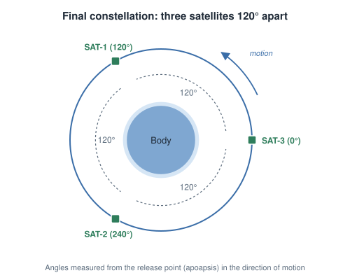
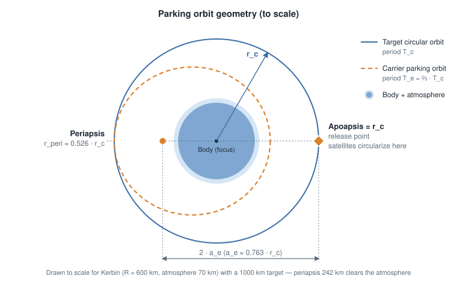
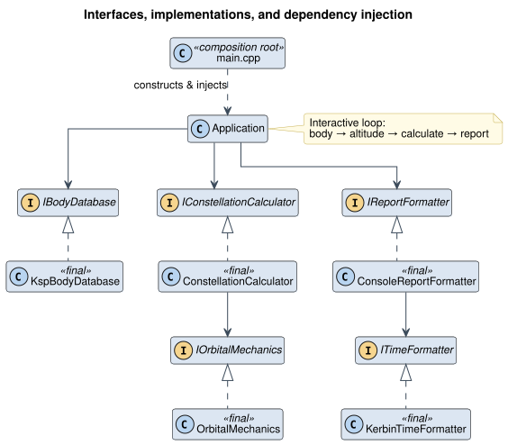
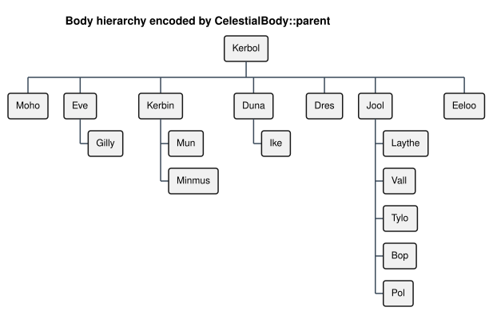
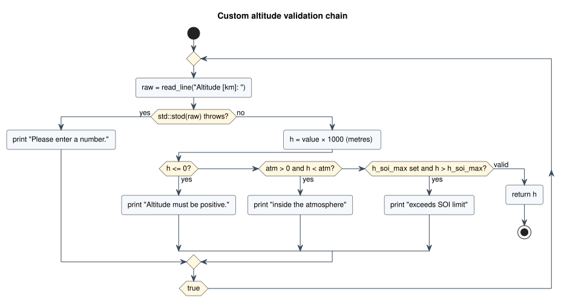

# KSP Relay Satellite Constellation Calculator

[](https://github.com/AlaNLrdE/KSP_RelayOrbiter_calculator/actions/workflows/docs.yml)

📖 **Full documentation: <https://alanlrde.github.io/KSP_RelayOrbiter_calculator/>**

An interactive C++20 command-line tool that computes the orbital parameters needed to deploy **3 relay satellites evenly spaced 120° apart** using a single carrier vessel — no manual timing, no mods required.

---

## Table of Contents

1. [Quick Start](#quick-start)
2. [Building](#building)
   - [Prerequisites](#prerequisites)
   - [Make Targets](#make-targets)
   - [GoogleTest Dependency](#googletest-dependency)
   - [Choosing a Compiler](#choosing-a-compiler)
   - [Troubleshooting](#troubleshooting)
3. [Running the Tests](#running-the-tests)
4. [Documentation](#documentation)
5. [Example Session](#example-session)
6. [Use Case](#use-case)
7. [Orbital Mechanics](#orbital-mechanics)
   - [The Core Constraint](#the-core-constraint)
   - [Deriving the Parking Orbit](#deriving-the-parking-orbit)
   - [Minimum Safe Altitude](#minimum-safe-altitude)
8. [Deployment Diagrams](#deployment-diagrams)
   - [Orbit Geometry](#orbit-geometry)
   - [Deployment Timeline](#deployment-timeline)
9. [Project Layout](#project-layout)
10. [Architecture](#architecture)
11. [API Reference](#api-reference)
12. [Data Model](#data-model)
13. [Input Validation & Edge Cases](#input-validation--edge-cases)
14. [Performance](#performance)
15. [Extending the Calculator](#extending-the-calculator)
16. [Supported Bodies](#supported-bodies)

---

## Quick Start

```sh
git clone --recurse-submodules <repo-url>
cd KSP_RelayOrbiter_calculator
make -C build                  # builds the app and runs the test suite
./build/obj/relay_calculator   # start the interactive calculator
```

---

## Building

### Prerequisites

| Requirement | Notes |
|-------------|-------|
| C++20 compiler | GCC 10+ or Clang 13+ (uses `<numbers>`, designated initializers, `std::optional`). Apple Clang from the Xcode Command Line Tools works. |
| GNU Make | 3.81 or newer (the version that ships with macOS is fine). |
| Git | Needed to fetch the GoogleTest submodule for the test build. |

No other external libraries are required to build or run the application.

### Make Targets

The Makefile lives in `build/`. Run it from the repository root with `make -C build <target>`, or `cd build && make <target>`.

| Target | Description |
|--------|-------------|
| `all` *(default)* | Builds the application and the test binary, then runs the tests. |
| `app` | Builds only the application → `build/obj/relay_calculator`. Does **not** need GoogleTest. |
| `test` | Builds and runs the GoogleTest suite → `build/obj/run_tests`. Fetches the GoogleTest submodule automatically if it is missing. |
| `html` | Builds the Sphinx documentation → `docs/_build/html/`. Checks and installs its dependencies first (see [Documentation](#documentation)). |
| `docs-clean` | Removes `docs/_build/`. |
| `clean` | Removes `build/obj/` (all object files and binaries). |

All build outputs go to `build/obj/`, which is git-ignored.

### GoogleTest Dependency

GoogleTest is included as a **git submodule** at `thirdparty/googletest`, pinned to a specific commit. The `.gitmodules` file only records *where* the submodule lives and *where to fetch it from* — a plain `git clone` leaves the folder empty.

You don't need to do anything special: the first `make test` (or `make`) detects the missing headers and runs

```sh
git submodule update --init --recursive
```

before compiling. To fetch it up front instead, either clone with `--recurse-submodules` or run the command above yourself.

GoogleTest and GoogleMock are compiled directly from source (`gtest-all.cc`, `gmock-all.cc`, `gtest_main.cc`) — there is no CMake step and nothing is installed system-wide.

### Choosing a Compiler

The Makefile defaults to `g++`. Override it on the command line:

```sh
make -C build CXX=clang++
make -C build CXX=g++-14
```

Run `make -C build clean` after switching compilers so stale object files are rebuilt.

### Troubleshooting

| Symptom | Cause / Fix |
|---------|-------------|
| `fatal error: 'gtest/gtest.h' file not found` | The GoogleTest submodule is not checked out and the automatic fetch failed (e.g. no network). Run `git submodule update --init --recursive` manually. |
| `git submodule status` shows a leading `-` | Submodule registered but not initialized — same fix as above. |
| `error: no member named 'numbers' in namespace 'std'` | Compiler too old or not in C++20 mode. Upgrade the compiler or pass a newer one via `CXX=`. |
| Changes to a header don't trigger a rebuild | The Makefile does not track header dependencies. Run `make -C build clean` and rebuild. |

---

## Running the Tests

```sh
make -C build test
```

The suite uses [GoogleTest](https://github.com/google/googletest) and currently contains **66 tests across 4 suites**:

| Suite | Tests | Covers |
|-------|------:|--------|
| `OrbitalMechanics` | 15 | Kepler period, vis-viva, synchronous altitude, SOI limit |
| `KspBodyDatabase` | 19 | Body lookup, catalogue completeness, `children_of()` ordering |
| `ConstellationCalculator` | 20 | Parking-orbit derivation, velocities, safety flags, minimum altitudes |
| `KerbinTimeFormatter` | 12 | Kerbin calendar formatting and rounding boundaries |

Shared test bodies (Kerbin, Mun, Kerbol) live in `utest/TestFixtures.hpp`, so math-only tests don't depend on `KspBodyDatabase`.

To run a subset, call the binary directly with a GoogleTest filter:

```sh
./build/obj/run_tests --gtest_filter='ConstellationCalculator.*'
```

---

## Documentation

Detailed documentation — user guide, orbital-mechanics derivation, architecture, per-class API reference, and PlantUML diagrams — is a Sphinx project in `docs/`, published at **<https://alanlrde.github.io/KSP_RelayOrbiter_calculator/>**.

The [Documentation workflow](.github/workflows/docs.yml) builds it on every push and pull request and deploys it to GitHub Pages from `master`. To build it locally:

```sh
make -C build html                   # or: make -C docs html
open docs/_build/html/index.html
```

`make html` checks and fetches its dependencies before building:

| Dependency | Check | If missing |
|------------|-------|------------|
| Python 3.10+ | `python3` on `PATH` and its version | Stops with an error (override with `PYTHON=/path/to/python3`). |
| [PlantUML](https://plantuml.com) | `plantuml` on `PATH` and runnable | Installed with `brew install plantuml` when Homebrew is available; otherwise stops with install instructions for macOS / Debian / Fedora. |
| Sphinx, Read the Docs theme, `sphinxcontrib-plantuml` | `docs/.venv` exists and is newer than `docs/requirements.txt` | Creates `docs/.venv` and installs `docs/requirements.txt`. |

Nothing Python-related is installed system-wide; `make -C docs distclean` removes the build output and the virtual environment.

The figures in this README live in `docs/images/`. Regenerate them after changing `docs/tools/orbit_figures.py` or the PlantUML sources with `make -C docs readme-images`.

---

## Example Session

Selecting Kerbin with a custom 1000 km altitude:

```
Select body (number or name): Kerbin

Target circular orbit altitude above Kerbin  (atmosphere ends at 70 km)
  1. Synchronous orbit  ->  2863.33 km
  2. At a moon's orbital distance
  3. Midpoint between two moons
  4. Custom altitude

  Option [1-4]: 4
  Altitude [km]: 1000

==============================================================
  RESULTS — Kerbin / target altitude 1000.00 km
==============================================================

  CIRCULAR ORBIT  (final satellite orbit)
  ------------------------------------------------------------
  Altitude                        : 1000.00  km
  Radius                          : 1600.00  km
  Orbital velocity                : 1485.682  m/s
  Orbital period                  : 0y 0d 1h 52m 46.7s  (6766.66 s)

  ELLIPTICAL PARKING ORBIT  (carrier vessel)
  ------------------------------------------------------------
  Apoapsis altitude               : 1000.00  km  (= target)
  Apoapsis radius                 : 1600.00  km
  Periapsis altitude              : 242.06  km  OK
  Periapsis radius                : 842.06  km
  Semi-major axis                 : 1221.03  km
  Orbital period                  : 0y 0d 1h 15m 11.1s  (4511.10 s)
  T_e / T_c ratio                 : 0.666667  (target 0.666667)

  VELOCITIES
  ------------------------------------------------------------
  Circular orbit (at apoapsis alt): 1485.682  m/s
  Carrier at apoapsis             : 1233.768  m/s
  Carrier at periapsis            : 2344.294  m/s

  DEPLOYMENT PROCEDURE
  ------------------------------------------------------------
   1. Circularize carrier at 1000.00 km.
   2. Burn retrograde at apoapsis to set periapsis to 242.06 km.
       (carrier is now in the elliptical parking orbit)
   3. At apoapsis: release SAT-1.  SAT-1 circularizes.
   4. Carrier completes 1 elliptical orbit  (0y 0d 1h 15m 11.1s).
       -> SAT-1 is now 120 deg ahead at apoapsis.
   5. At apoapsis: release SAT-2.  SAT-2 circularizes.
   6. Carrier completes 1 more elliptical orbit  (0y 0d 1h 15m 11.1s).
       -> SAT-1 at 120 deg, SAT-2 at 240 deg ahead.
   7. At apoapsis: release SAT-3.  SAT-3 circularizes.
   8. Constellation complete: 3 satellites, 120 deg spacing.

==============================================================

Calculate for another body/altitude? [y/N]: n

Good luck with the mission!
```

Times are shown in the Kerbin calendar (6-hour day, 426-day year) followed by raw seconds.

---

## Use Case

The goal is to deploy a relay network of 3 satellites in a circular orbit with equal angular spacing (120° apart), using one carrier ship that carries all three. The method avoids any need to measure angles in-flight — the geometry is guaranteed by choosing the correct parking orbit before launch.

<p align="center"></p>

---

## Orbital Mechanics

### The Core Constraint

Let:
- `r_c` = radius of the target circular orbit (body center to satellite)
- `T_c` = period of the circular orbit
- `T_e` = period of the carrier's elliptical parking orbit

When the carrier releases SAT-1 at apoapsis and SAT-1 circularizes, both objects are at the same position. After one full elliptical orbit (`T_e`), the carrier returns to apoapsis. In that same time, SAT-1 has traveled:

```
θ_SAT1 = (T_e / T_c) × 360°
```

For the carrier to be exactly 120° behind SAT-1 at that moment, SAT-1 must have advanced 240° (i.e., 360° − 120°):

```
T_e / T_c = 240° / 360° = 2/3
```

This single ratio drives the entire calculation.

### Deriving the Parking Orbit

From **Kepler's Third Law**, the orbital period scales with the semi-major axis:

```
T ∝ a^(3/2)
```

Therefore:

```
T_e / T_c = (a_e / r_c)^(3/2) = 2/3

a_e = r_c × (2/3)^(2/3)  ≈  r_c × 0.76314
```

The apoapsis of the elliptical orbit equals the circular orbit radius (the release point):

```
r_apo = r_c
```

The periapsis follows from the definition of semi-major axis:

```
a_e = (r_apo + r_peri) / 2
r_peri = 2 × a_e − r_apo
       = r_c × (2 × (2/3)^(2/3) − 1)
       ≈ r_c × 0.52629
```

Orbital velocities at each key point are computed via the **vis-viva equation**:

```
v = √(μ × (2/r − 1/a))
```

Where `μ` is the body's standard gravitational parameter (GM).

### Minimum Safe Altitude

The periapsis must clear the body's surface (and atmosphere, if any). Setting `r_peri > R_body`:

```
r_c × 0.52629 > R_body
r_c > R_body / 0.52629 ≈ 1.9001 × R_body
h_target > 0.9001 × R_body
```

For bodies with an atmosphere, the periapsis must instead clear `R_body + h_atm`, which is always the stricter limit:

```
h_target > (R_body + h_atm) / 0.52629 − R_body
```

Minimum altitudes for selected bodies:

| Body   | Min altitude (surface) | Atmosphere top | Min altitude (atmosphere) | Binding constraint |
|--------|------------------------|----------------|---------------------------|--------------------|
| Kerbin | 540.1 km               | 70 km          | 673.1 km                  | 673.1 km           |
| Mun    | 180.0 km               | none           | —                         | 180.0 km           |
| Minmus | 54.0 km                | none           | —                         | 54.0 km            |
| Duna   | 288.0 km               | 50 km          | 383.0 km                  | 383.0 km           |
| Eve    | 630.1 km               | 90 km          | 801.1 km                  | 801.1 km           |
| Laythe | 450.1 km               | 50 km          | 545.1 km                  | 545.1 km           |
| Jool   | 5,400.7 km             | 200 km         | 5,780.7 km                | 5,780.7 km         |

---

## Deployment Diagrams

### Orbit Geometry

<p align="center"></p>

| Quantity | Value |
|----------|-------|
| Apoapsis radius | `r_apo = r_c` (release point) |
| Semi-major axis | `a_e = r_c · (2/3)^(2/3) ≈ 0.763 · r_c` |
| Periapsis radius | `r_peri = 2·a_e − r_c ≈ 0.526 · r_c` |
| Parking orbit period | `T_e = (2/3) · T_c` |

### Deployment Timeline

<p align="center"></p>

| Time | Satellites already deployed | Action at apoapsis (0°) |
|------|-----------------------------|-------------------------|
| `t = 0` | — | Release SAT-1 |
| `t = T_e` | SAT-1 at 240° | Release SAT-2 |
| `t = 2·T_e` | SAT-1 at 120°, SAT-2 at 240° | Release SAT-3 |
| Done | SAT-3 at 0°, SAT-1 at 120°, SAT-2 at 240° | Equal 120° spacing, guaranteed by orbital mechanics alone |

---

## Project Layout

```
KSP_RelayOrbiter_calculator/
├── build/
│   ├── Makefile                     Build, test, and clean targets
│   └── obj/                         Build outputs (git-ignored)
├── docs/                            Sphinx documentation + PlantUML diagrams
├── hpp/                             Public headers
│   ├── CelestialBody.hpp            Body data struct
│   ├── OrbitalResult.hpp            Calculation result value object
│   ├── IOrbitalMechanics.hpp        ┐
│   ├── IBodyDatabase.hpp            │
│   ├── IConstellationCalculator.hpp │ Interfaces
│   ├── IReportFormatter.hpp         │
│   ├── ITimeFormatter.hpp           ┘
│   ├── OrbitalMechanics.hpp         ┐
│   ├── KspBodyDatabase.hpp          │
│   ├── ConstellationCalculator.hpp  │ Concrete implementations
│   ├── ConsoleReportFormatter.hpp   │
│   ├── KerbinTimeFormatter.hpp      ┘
│   └── Application.hpp              Interactive CLI orchestrator
├── src/                             Implementations (+ main.cpp)
├── utest/                           GoogleTest suites + TestFixtures.hpp
└── thirdparty/googletest/           GoogleTest git submodule
```

---

## Architecture

The program is built around small interfaces with one concrete implementation each, wired together in `main.cpp` (the composition root):

<p align="center"></p>

Design principles applied:

| Principle | Where |
|-----------|-------|
| **Single Responsibility** | Math (`OrbitalMechanics`), data (`KspBodyDatabase`), derivation (`ConstellationCalculator`), output (`ConsoleReportFormatter`), time formatting (`KerbinTimeFormatter`), and I/O flow (`Application`) are separate classes. |
| **Dependency Inversion** | Every class depends on interfaces received via `std::shared_ptr` constructor injection; only `main.cpp` names concrete types. |
| **Interface Segregation** | Each interface exposes only what its consumers need (e.g. `IBodyDatabase` is read-only). |
| **Open/Closed** | A new calendar, output format, or body catalogue is a new class implementing an existing interface — `Application` stays unchanged. |
| **Data-driven** | All body parameters live in one static table in `KspBodyDatabase.cpp`; menus, SOI checks, and child-body options derive from it. |

Value types (`CelestialBody`, `OrbitalResult`) are plain structs with no behaviour, which keeps the calculation pure and easy to assert on in tests.

---

## API Reference

### `IOrbitalMechanics`

#### `double orbital_period(double semi_major_axis, double mu) const`

```
T = 2π √(a³ / μ)
```

- `semi_major_axis`: semi-major axis (m)
- `mu`: gravitational parameter GM (m³/s²)
- Returns: period in seconds

#### `double vis_viva(double r, double semi_major_axis, double mu) const`

```
v = √(μ × (2/r − 1/a))
```

- `r`: current orbital radius (m)
- `semi_major_axis`: semi-major axis of the orbit (m)
- `mu`: gravitational parameter (m³/s²)
- Returns: orbital speed (m/s)

Special cases:
- Circular orbit: `r = a`, gives `v = √(μ/r)`
- At apoapsis of the parking orbit: `r = r_c`, `a = a_e`
- At periapsis of the parking orbit: `r = r_peri`, `a = a_e`

#### `std::optional<double> sync_orbit_altitude(const CelestialBody& body) const`

Derives the synchronous (geostationary) orbit altitude from the body's sidereal rotation period:

```
r_sync = (μ × (T_rot / 2π)²)^(1/3)
h_sync = r_sync − R_body
```

The interface allows `std::nullopt` for an unusable sync orbit; the current `OrbitalMechanics` implementation always returns a value. SOI is **not** checked here — `Application` compares the result against `soi_max_altitude()`.

#### `std::optional<double> soi_max_altitude(const CelestialBody& body) const`

```
h_SOI_max = SOI_radius − R_body
```

Returns `std::nullopt` for Kerbol (no SOI limit).

### `IBodyDatabase`

| Method | Description |
|--------|-------------|
| `std::optional<CelestialBody> find(std::string_view name) const` | Exact, case-sensitive name lookup. |
| `std::vector<CelestialBody> all() const` | Every body in catalogue order. |
| `std::vector<CelestialBody> children_of(std::string_view parent) const` | Direct children sorted by `orbital_radius` ascending. Drives the "moon/planet orbital distance" and "midpoint" menu options. |

### `IConstellationCalculator`

#### `OrbitalResult calculate(const CelestialBody& body, double h_target) const`

The core engine. Takes a body and a target circular altitude in metres, applies the `T_e = (2/3)·T_c` derivation, and returns a fully populated [`OrbitalResult`](#orbitalresult). No I/O, no side effects.

### `IReportFormatter`

#### `void print(const OrbitalResult& result) const`

`ConsoleReportFormatter` writes the four report sections (circular orbit, parking orbit, velocities, deployment procedure) to stdout, plus a warning block when the periapsis is unsafe.

### `ITimeFormatter`

#### `std::string format(double seconds) const`

`KerbinTimeFormatter` renders seconds as `Xy Xd Xh Xm X.Xs` using a 6-hour day and 426-day year.

### `Application`

#### `void run()`

The interactive loop: select a body → choose an altitude from a context-aware menu → calculate → print the report → repeat or exit.

---

## Data Model

### `CelestialBody`

| Field            | Type                         | Unit  | Description                                             |
|------------------|------------------------------|-------|---------------------------------------------------------|
| `name`           | `std::string`                | —     | Body name                                               |
| `radius`         | `double`                     | m     | Mean equatorial radius                                  |
| `mu`             | `double`                     | m³/s² | Standard gravitational parameter (GM)                   |
| `atm`            | `double`                     | m     | Altitude of atmosphere top (0 if none)                  |
| `rot_period`     | `double`                     | s     | Sidereal rotation period                                |
| `soi`            | `std::optional<double>`      | m     | Sphere of Influence radius (`nullopt` for Kerbol)       |
| `orbital_radius` | `std::optional<double>`      | m     | Semi-major axis of orbit around parent (`nullopt` for Kerbol) |
| `parent`         | `std::optional<std::string>` | —     | Name of parent body (`nullopt` for Kerbol)              |

The parent-child graph encoded in the `parent` fields:

<p align="center"></p>

### `OrbitalResult`

All distances in metres, times in seconds, velocities in m/s.

| Field           | Description                                          |
|-----------------|------------------------------------------------------|
| `body_name`     | Name of the body                                     |
| `h_target`      | Target circular orbit altitude                       |
| `r_c`           | Circular orbit radius                                |
| `T_c`           | Circular orbit period                                |
| `v_c`           | Circular orbit velocity                              |
| `T_e`           | Elliptical orbit period = (2/3)·T_c                  |
| `a_e`           | Elliptical orbit semi-major axis                     |
| `r_apo` / `h_apo` | Apoapsis radius / altitude (= `r_c` / `h_target`)  |
| `r_peri` / `h_peri` | Periapsis radius / altitude                      |
| `v_apo`         | Carrier velocity at apoapsis                         |
| `v_peri`        | Carrier velocity at periapsis                        |
| `surface_ok`    | `true` if periapsis is above the surface             |
| `atm_ok`        | `true` if periapsis clears the atmosphere (or none)  |
| `min_h_surface` | Minimum `h_target` for periapsis above the surface   |
| `min_h_atm`     | Minimum `h_target` for periapsis above the atmosphere (`nullopt` if no atmosphere) |

---

## Input Validation & Edge Cases

Every user input is validated before it reaches `calculate()`; invalid input re-prompts instead of exiting.

### Body selection

Accepts either the menu number or the exact (case-sensitive) body name. Bodies are listed alphabetically.

### Altitude menu

The menu is built at runtime from the selected body:

| # | Option | Shown when |
|---|--------|------------|
| 1 | Synchronous orbit | Always |
| 2 | At a moon's / planet's orbital distance | The body has at least one child |
| 3 | Midpoint between two moons / planets | The body has two or more children |
| 4 | Custom altitude | Always (last option) |

For the midpoint option, the same child cannot be picked twice.

### Custom altitude validation chain

<p align="center"></p>

### Bodies with synchronous orbit outside SOI

9 of the 17 bodies have synchronous orbits that exceed their SOI:

| Body   | Sync orbit  | SOI limit   | Ratio |
|--------|-------------|-------------|-------|
| Mun    | 2,970.6 km  | 2,229.6 km  | 1.33× |
| Minmus | 3,670.4 km  | 2,187.4 km  | 1.68× |
| Ike    | 1,133.9 km  |   919.6 km  | 1.23× |
| Vall   | 3,593.8 km  | 2,106.4 km  | 1.71× |
| Bop    | 2,588.2 km  | 1,156.1 km  | 2.24× |
| Pol    | 2,415.1 km  |   998.1 km  | 2.42× |
| Laythe | 4,686.3 km  | 3,223.6 km  | 1.45× |
| Tylo   | 14,157.9 km | 10,256.5 km | 1.38× |
| Moho   | 18,173.2 km | 9,396.7 km  | 1.93× |

For these bodies, option 1 is labelled `(exceeds SOI limit …)` and is rejected if selected, asking the user to pick another option.

### Low periapsis warning

A target altitude can pass validation (above the atmosphere, below the SOI) yet still produce a parking orbit whose periapsis is underground or inside the atmosphere. In that case the report marks the periapsis row and appends:

```
  !!!!!!!!!!!!!!!!!!!!!!!!!!!!!!!!!!!!!!!!!!!!!!!!!!!!!!!!!!!!
  Periapsis is inside the atmosphere!
     Minimum target altitude (clear of atmosphere): 673.1 km
  !!!!!!!!!!!!!!!!!!!!!!!!!!!!!!!!!!!!!!!!!!!!!!!!!!!!!!!!!!!!
```

The minimum altitudes are derived analytically:

```
factor        = 2 × (2/3)^(2/3) − 1 ≈ 0.52629
h_min_surface = R / factor − R
h_min_atm     = (R + h_atm) / factor − R
```

---

## Performance

All orbital computations are **O(1)** closed-form expressions with no iteration.

The body catalogue holds 17 entries, so `find()` and `children_of()` are linear scans (`children_of()` adds an `O(k log k)` sort over at most 5 children). Total computation per calculation is on the order of microseconds; runtime is entirely dominated by user I/O.

**Numerical precision:** the `T_e / T_c` ratio is shown to 6 decimal places in the report and is verified against `2/3` in the test suite.

---

## Extending the Calculator

| To… | Do this |
|-----|---------|
| Add a modded body | Append one entry to the static table in `src/KspBodyDatabase.cpp`. Menus, SOI checks, and child-body options pick it up automatically. |
| Use a different calendar (e.g. Earth time) | Implement `ITimeFormatter` and inject it in `main.cpp`. |
| Change the output format (e.g. JSON, CSV) | Implement `IReportFormatter` and inject it in `main.cpp`. |
| Load bodies from a file | Implement `IBodyDatabase` and inject it in `main.cpp`. |

Add matching tests under `utest/` (`test_*.cpp` files are picked up by the Makefile automatically).

---

## Supported Bodies

| #  | Body    | Radius      | μ (m³/s²)  | Atmosphere | SOI          | Children    |
|----|---------|-------------|------------|------------|--------------|-------------|
| 1  | Kerbol  | 261,600 km  | 1.172×10¹⁸ | none       | unlimited    | 7 planets   |
| 2  | Moho    | 250 km      | 1.686×10¹¹ | none       | 9,647 km     | —           |
| 3  | Eve     | 700 km      | 8.172×10¹² | 90 km      | 85,109 km    | Gilly       |
| 4  | Gilly   | 13 km       | 8.289×10⁶  | none       | 126 km       | —           |
| 5  | Kerbin  | 600 km      | 3.532×10¹² | 70 km      | 84,159 km    | Mun, Minmus |
| 6  | Mun     | 200 km      | 6.514×10¹⁰ | none       | 2,430 km     | —           |
| 7  | Minmus  | 60 km       | 1.766×10⁹  | none       | 2,247 km     | —           |
| 8  | Duna    | 320 km      | 3.014×10¹¹ | 50 km      | 47,922 km    | Ike         |
| 9  | Ike     | 130 km      | 1.857×10¹⁰ | none       | 1,050 km     | —           |
| 10 | Dres    | 138 km      | 2.148×10¹⁰ | none       | 32,833 km    | —           |
| 11 | Jool    | 6,000 km    | 2.825×10¹⁴ | 200 km     | 2,455,985 km | 5 moons     |
| 12 | Laythe  | 500 km      | 1.962×10¹² | 50 km      | 3,724 km     | —           |
| 13 | Vall    | 300 km      | 2.075×10¹¹ | none       | 2,406 km     | —           |
| 14 | Tylo    | 600 km      | 2.825×10¹² | none       | 10,857 km    | —           |
| 15 | Bop     | 65 km       | 2.487×10⁹  | none       | 1,221 km     | —           |
| 16 | Pol     | 44 km       | 7.217×10⁸  | none       | 1,042 km     | —           |
| 17 | Eeloo   | 210 km      | 7.441×10¹⁰ | none       | 119,083 km   | —           |
